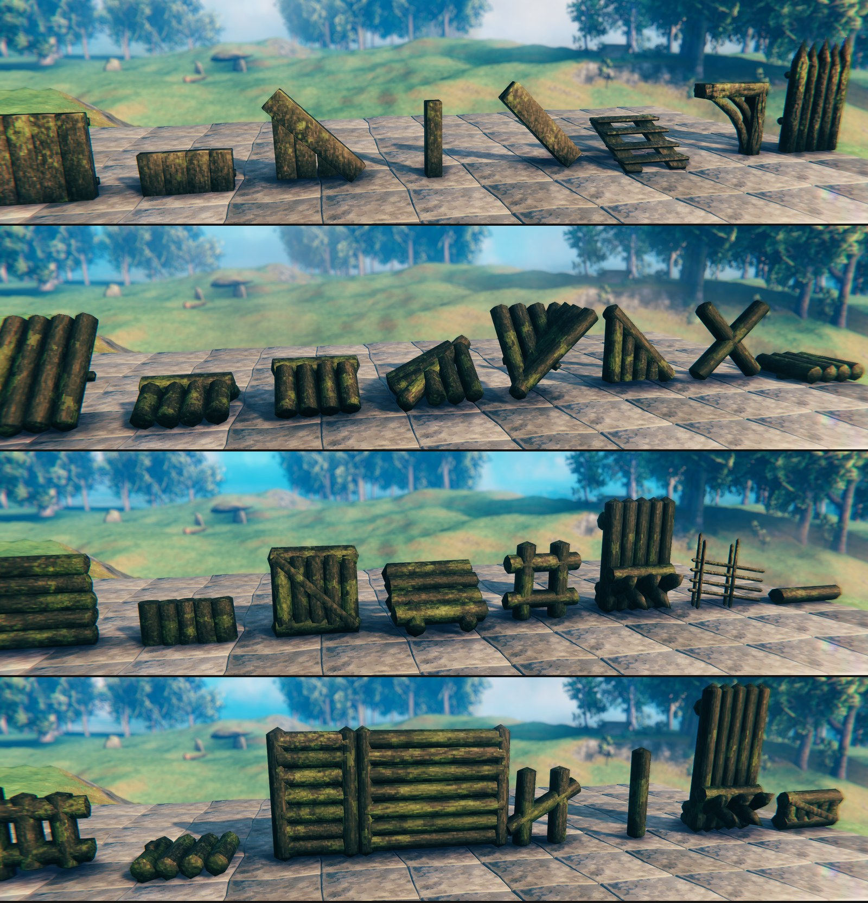

# Ancient Bark Pieces

Build pieces made out of ancient bark, so you can finally put up a base in the swamp that looks like it belongs there. Dark bark, a bit of moss, same chunky pixel look as the vanilla wood.

I always end up with stacks of ancient bark and nothing to do with it, so this is that.

**Heads up:** this mod was made with AI tools. The code was written with Claude Code and the icon came from an AI image generator. The bark and moss textures are recoloured from the game's own swamp tree.

## What you get

Everything is on the hammer, costs Ancient Bark and needs a workbench. Costs are the same amounts as the wood version of each piece, just paid in bark.

Plank pieces (always there):

- floors 2x2 and 1x1
- wall, half wall, quarter wall
- gable walls for 26 and 45 degree roofs, including the tops and the upside down ones
- poles 1m and 2m, beams 1m and 2m, angled beams 26 and 45
- a 4m pole, a 4m beam and an arch
- stair and ladder
- door and gate
- log poles and log beams (the core wood shapes), including the angled ones
- stakewall and roundpole fence

Log pieces (only if you have CoreWoodPieces, see below):

- log roofs: 26 and 45 degree slopes, ridges, inner and outer corners
- log gables and roof crosses
- log walls (vertical and horizontal), half wall, floor, stair
- window and half window
- log gate, fence gate and trapdoor
- four drawbridges
- two fences, a fence pillar, palisade and tall palisade

The roof logs get a bit more moss toward the bottom edge and the ridge logs are mossier than the rest. Each log picks a different bit of bark depending on where you place it, so a big roof doesn't look like the same four logs copy pasted.

## CoreWoodPieces

The log pieces are bark versions of the pieces from [CoreWoodPieces by blacks7ar](https://thunderstore.io/package/blacks7ar/CoreWoodPieces/). Nothing from that mod is included here. This mod copies those pieces from your installed CoreWoodPieces when the game starts and puts the bark on them.

So with CoreWoodPieces installed you get all 65 pieces. Without it the mod still works, you just get the 32 plank pieces and no log roofs. If you want roofs, install it.

All credit for those shapes goes to blacks7ar.

## Install

Use a mod manager, or drop `AncientBarkPieces.dll` into `BepInEx/plugins`.

Needs Jotunn. CoreWoodPieces is optional but you really want it.

## Multiplayer

It adds build pieces, so everyone on the server needs it, and so does a dedicated server. Everyone should also agree on whether CoreWoodPieces is installed.

## Good to know

- The bark on plank pieces is mapped to the world, not to each piece. That's why walls don't repeat the same plank over and over, but it also means the pattern on a door shifts a little while it swings.
- The arch and the 4m pole and beam are based on the darkwood ones and keep their carved grooves.
- No config. If you want different costs, tell me.
- If you remove the mod, anything you built with it disappears from the world.

## Source

https://github.com/JellyDOTexe/AncientBarkPieces (MIT)
